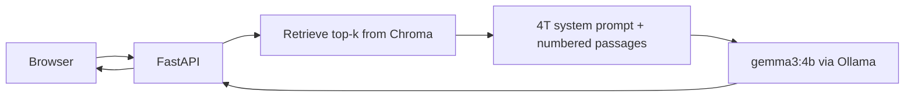

# Planet Quiz: Synopsis

## 1. Problem, users, purpose and MVP scope

**Problem.** Writing quiz questions for school astronomy by hand takes a long time, and somebody also has to check the answers. A normal chatbot could do it, but it answers from memory and does not show where the answer comes from. We saw this ourselves: we asked our local model how many moons Saturn has. In one run it said 83 and in another run it said 146. If a quiz uses a wrong answer as the correct one, the player learns something wrong.

**Purpose and role of the LLM.** Planet Quiz is a small web app with trivia about the solar system. The facts come from two documents that we load into the app. The local LLM does three jobs with those facts: it writes quiz questions, it answers free questions, and it grades the answers the player types. Every answer is shown together with the text passage it came from, so the player can check it. The two documents are a set of NASA fact sheets for teachers (42 pages, each planet has a FAST FACTS table) and a brochure from the German Aerospace Center, DLR (100 pages). Both are from 2013.

**Users.** Students aged about 12 to 18 and their teachers. The NASA material is made for school classes. Students get feedback that they can check against the source. Teachers get questions with sources without having to write them.

**MVP scope.** The app is one web page with two modes:

- *Quiz*: the player picks one of 15 topics. The model writes a question and a reference answer from passages it has retrieved. The player types an answer, and the app grades it as correct, partially correct or incorrect, gives a short feedback text, shows the sources and keeps a score.
- *Ask*: the player asks a free question. A checkbox turns retrieval on or off, and a "Compare with and without RAG" button shows both answers next to each other.

**Out of scope.** We did not build user accounts, saving of quiz state (it is kept in memory and lost on restart), streaming of answers, chat with several turns, automatic evaluation or deployment.

## 2. Architecture and implementation

Both models run locally in Ollama, so no data leaves the machine. The app is written in Python 3.12. We use FastAPI for the web server (a JSON API and one static HTML page), LangChain for the LLM and RAG parts, and Chroma as the vector database.

**Flow in Ask mode.** The endpoint `/api/ask` turns the question into a vector, finds the 4 passages that are most similar, numbers them and sends them to the model together with the question. The answer is returned together with the passages. When RAG is turned off, the retrieval step is skipped and the model answers from memory.

**Flow in Quiz mode.** `/api/quiz/question` finds the 8 best passages for the topic and picks 2 of them at random, so we do not get the same question every time. The model answers with three lines (FACT, QUESTION and ANSWER), which we read in `rag.py`. If the reply does not have this format we ask again, up to 3 times, and after that the player gets an error message and can try again. The server keeps the reference answer, and the browser only gets the question. `/api/quiz/grade` does not retrieve anything. Its prompt only contains the question, the reference answer and the player's answer.

**Local LLM.** We use `gemma3:4b` (3.4 GB) through LangChain's `ChatOllama`, with temperature 0.2. A model with 4 billion parameters is small enough to run on a 16 GB laptop (Apple M2) together with the embedding model `nomic-embed-text` (274 MB). An answer takes about 3 to 25 seconds without a graphics card. The price of a small model is that it knows less and is worse at following instructions. The model names are settings, so a bigger model can be used without changing the code.

**RAG with LangChain.** These are the LangChain parts we use:

| Component | What it does here |
| --- | --- |
| `PyMuPDFLoader` | Reads the PDF and gives one document per page |
| `RecursiveCharacterTextSplitter` | Cuts the pages into chunks of 1000 characters with 150 characters overlap |
| `OllamaEmbeddings` | Calls `nomic-embed-text` to turn text into vectors |
| `Chroma` | Stores the vectors on disk and finds the most similar ones |
| `ChatPromptTemplate`, `ChatOllama` | Build the messages and call the chat model |
| Chains | `prompt \| llm \| parser`, with automatic retry for the quiz prompts |

## 3. How the 4T's are applied

All prompt text is in `app/prompts.py`. The function `_system()` builds every system prompt from four labelled parts: TRAITS, TASK, TONE and TARGET. This means the 4T's are real text that is sent to the model, and not only something we thought about. Traits and Task are different for each prompt. Tone and Target are shared by all of them.

| T | Wording in `app/prompts.py` | Constant |
| --- | --- | --- |
| Traits | "You are a careful planetary-science tutor in a trivia app. You rely only on the numbered source passages you are given and never add facts from memory. The sources were published in 2013: when a passage disagrees with what you remember, the passage wins." | `TRAITS_WITH_SOURCES` (also `TRAITS_WITHOUT_SOURCES` and `TRAITS_GRADER`) |
| Task | For Ask: "Answer the player's question using only the numbered passages in the user message. Start with the direct answer, then cite the passages you used like [1] or [2]." | `ASK_WITH_CONTEXT`, `QUIZ_QUESTION`, `QUIZ_GRADE` |
| Tone | "Encouraging and concise. Use plain language and no unexplained jargon. Never invent facts. Give the reply itself only: no greeting and no follow-up questions or offers." | `TONE` |
| Target | "Your readers are students aged about 12 to 18 with no astronomy background. [...] Keep every reply short: at most 4 sentences." | `TARGET` |

**Key design decisions.** These are the choices we learned the most from.

- **The persona wording matters.** In our first version, Traits said the model was a "quiz master". The model then added its own "Quiz question: ..." at the end of normal answers in Ask mode, even though nobody asked for it. When we changed the text to "tutor in a trivia app", the problem went away. We learned that a small model reacts to every word in its persona.
- **Grading only against the reference answer.** At first the grading prompt also contained the source passages. Then the model accepted "It takes about 248 years to orbit the Sun" as correct for the question "What year was Pluto discovered?". The sentence is true, but it does not answer the question. Now the grader only sees the question, the reference answer and the player's answer. After this change we tested 18 answers by hand, and 17 verdicts were right. The sample is small, and the feedback text is still strange sometimes.
- **Labelled lines instead of JSON.** We first asked the model to reply in JSON for the quiz. Sometimes the reply was broken and the request hung for minutes. Now the quiz prompts ask for simple lines such as `QUESTION: ...` and `ANSWER: ...`, and we ask again if the format is wrong.
- **The passages win over the model's memory.** Our sources are from 2013, and the model likes to "correct" them with numbers it half remembers. The prompt therefore says that the passage wins. If the passages do not contain the answer, the model must say "The sources I have do not say.". The passages are numbered, so the model can cite `[1]` and the web page shows the same numbers.
- **The mode without RAG keeps the 4T's.** Persona, tone, target and length are the same with and without RAG. Only the sentences about sources are different. This makes the comparison fair, because retrieval is the only thing that changes.

## 4. Machine learning concepts, data preparation and retrieval

**Data preparation** (`app/ingest.py`). We read one page at a time from the PDFs. The function `clean()` repairs words that are split by a hyphen at a line break and removes extra spaces. Pages with less than 500 characters are dropped, because they are covers, captions or pages with only pictures. 119 pages are kept and 23 are dropped. After that the text is cut into 532 chunks. The chunk size is a trade-off: a big chunk keeps a fact together with its context, but it is less precise to search in and it fills the prompt. A small chunk is precise, but a number can be separated from its label. The overlap of 150 characters means that a sentence that is cut at the border of a chunk is still whole in the next one. We did not have time to test other chunk sizes.

**Embeddings and cosine similarity.** An embedding model turns a text into a long list of numbers, called a vector. Texts with a similar meaning get vectors that point in a similar direction. To compare two vectors we use cosine similarity:

$$\cos(\mathbf{a},\mathbf{b}) = \frac{\mathbf{a}\cdot\mathbf{b}}{\lVert\mathbf{a}\rVert\,\lVert\mathbf{b}\rVert}$$

The result is close to 1 when the two vectors point in the same direction. Cosine similarity only looks at the direction and not at the length of the vector, so a short question can match a long chunk about the same topic. For each question we retrieve the 4 most similar chunks. With more chunks the small model gets more text that can confuse it, and with fewer we may miss the fact. Our embedding model is trained with a short prefix in front of the text (`search_document: ` for chunks and `search_query: ` for questions), so we add these prefixes when we embed.

**The model is not retrained.** The weights of the LLM were fixed when its training ended, so its knowledge stops at that date. RAG does not train the model. It only puts text into the prompt for one question. We can see the effect in Ask mode. With RAG, "How many moons does Saturn have?" gave: "Saturn has 53 known moons (plus 9 awaiting official confirmation). Passage [4] states this directly." This is what the 2013 source says. Without RAG the model said "Saturn has 83 confirmed moons!", and in an earlier run it said 146. When the model has no passages it produces a number that sounds right. This is called hallucination. The number also changes between runs, because the model picks its words with some randomness.

**Data quality.** The quality of the documents decides the quality of the answers. We saw this in two ways. First, our first PDF library (`pypdf`) broke words in the DLR brochure, for example "ne ptune" and "ur anus". We changed to PyMuPDF, and the index went from 502 chunks to 532 chunks with correct words. Second, the sources are from 2013, so the app says 53 moons for Saturn even though more have been found since then. The app is true to its sources, but it is not up to date. This is a limitation that the user has to know about.

## 5. Results and reflection: linear regression vs. local LLM + RAG

**Task and data.** In the separate experiment we predict how many Earth years a body needs to go around the Sun, from its distance to the Sun in astronomical units (AU, where Earth is 1). The data is nine bodies from the FAST FACTS tables in the NASA PDF, plus one body that we made up at 15 AU. Its correct period is 58.09 years, calculated with Kepler's third law. We added it because the LLM cannot know it from its training. Seven bodies are used for training (Mercury, Venus, Earth, Jupiter, Saturn, Neptune, Pluto) and three for testing (Mars, Uranus and the made-up body). The script checks that no test body and no test answer is in the RAG collection, and it stops if one is.

**Linear regression.** Linear regression finds the straight line that fits the training points best. Our data is not a straight line, because the period grows faster than the distance. Kepler's third law says $T = a^{1.5}$. If we take the logarithm of both numbers, this becomes $\log T = 1.5\log a$, which is a straight line. So we train scikit-learn's `LinearRegression` on the logarithms. The slope it finds is 1.4998, which is almost exactly Kepler's 1.5. For comparison we also train a line on the raw numbers without logarithms.

**LLM + RAG.** The RAG collection has one short sentence for each training body with its distance and period, and one general note. For each test case we only give the distance. The 4 most similar sentences are put in the prompt as examples, and the model must answer with one number. Here we use JSON output, and it works because the reply is only a single number. We also run the same prompt without examples. The LLM does not get the regression model, its numbers or the possibility to run code.

**Error measure.** We use the mean absolute error (MAE). For each test case we take the difference between the predicted and the actual value without the sign, and then we take the average of the three: $\text{MAE} = \frac{1}{n}\sum |\text{predicted} - \text{actual}|$.

Predicted period in Earth years:

| Test case | Distance (AU) | Actual | Log-log regression | Raw regression | LLM + RAG | LLM, no RAG |
| --- | --- | --- | --- | --- | --- | --- |
| Mars | 1.5237 | 1.88 | 1.88 | -2.39 | 0.41 | 0.62 |
| Uranus | 19.191 | 84.02 | 84.00 | 107.85 | 14.11 | 176.35 |
| Made-up body | 15 | 58.09 | 58.05 | 81.70 | 13.30 | 17.20 |
| **MAE (years)** | | | **0.02** | **17.24** | **38.73** | **44.83** |

MAE is mostly decided by the big numbers. If we look at the error in percent instead, the raw line (99 %) is worse than the LLM with RAG (80 %), because it predicts a negative period for Mars. The log-log regression is best with both measures (0.05 %).

**What was retrieved.** The same four bodies were retrieved for all three test cases: Earth, Mercury, Venus and Neptune. Earth was always first, with a similarity of about 0.84. Jupiter and Saturn were never retrieved, even though Saturn is the body closest to two of the test distances. The full lists are in `experiment/results.md`.

**Why the two approaches differ.**

- The regression is made for exactly this kind of task. It finds two numbers (slope and intercept) that describe the pattern in the data. In the log-log version the pattern really is a straight line, so the error is almost zero. The raw line has the wrong shape for the data.
- The LLM predicts the next word. It does not calculate, and it did not find the pattern from four examples. One example in the prompt was Neptune with 30.07 AU and 164.79 years, but for 19.19 AU the model answered 14.11 years. For Mars it answered 0.41 years, which is less than Earth's 1 year, although Mars is further away.
- Retrieval finds text that is similar, not numbers that are close. Our example sentences are almost the same text with different numbers, so the embedding model cannot tell which ones are numerically closest.

**Was RAG useful?** Only a little. MAE is lower with RAG (38.73 against 44.83), but the whole difference comes from Uranus. For Mars and the made-up body the answer with RAG was slightly worse. With three test cases and one run we cannot say that RAG helped. Our conclusion is that RAG helps when the answer is a fact that can be found in a text, like in our app, and not when the model has to work out a numeric pattern.

**When is a specialised model better?** When both the input and the answer are numbers and there is a pattern between them. Our regression is exact here, it is fast, and it gives the same result every time. An LLM is better when the task is about language, for example finding, quoting and grading text.

**Limitations.**

- RAG does not guarantee a correct answer. Asked if a spacecraft has visited Pluto, the model said: "Yes, a spacecraft has visited Pluto. The New Horizons spacecraft is scheduled to arrive at Pluto in 2015 [2, 6]." It follows the 2013 text but still starts with "Yes", and it cites passage 6 although it only got 4 passages. Our code does not check the citations.
- The feedback from grading is sometimes strange, and some quiz questions are about small details because the passages are picked at random.
- The app is slow on a laptop: 3 to 25 seconds for an answer.
- The experiment only has three test cases and one run, and the settings for a bigger model on a graphics card in `configs/` are not tested.

**Possible improvements.**

- Combine vector search with keyword search, so that exact names and numbers are matched better.
- Cut the FAST FACTS tables in a smarter way, so that a label and its value always stay in the same chunk.
- Use a bigger model on a graphics card.
- Let the LLM use a calculator tool for numeric tasks, as a new experiment.
- Make a larger test set for grading, and add a check that the passage numbers the model cites really exist.
